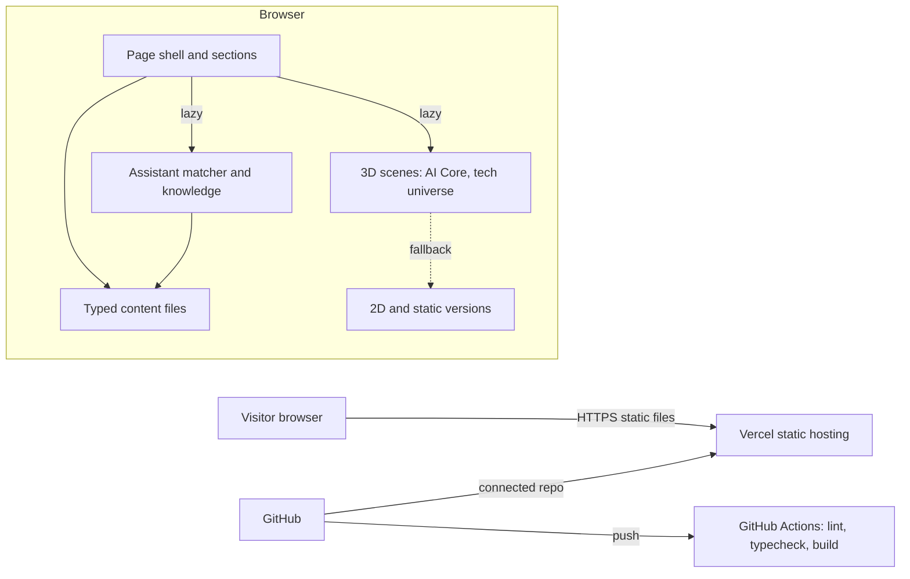

# High Level Design: AI Developer Lab (personal portfolio)

- Task: none
- Author: Thani, drafted with Claude Code, 2026-10-04
- Status: Reviewed
- PRD: PRD.md
- ADRs: docs/architecture/decisions.md
- Tenets: docs/architecture/tenets.md
- Serves: PRD.md, BACKLOG.md (30 current items), ADR-0001, ADR-0002, ADR-0003

## Summary

A static single-page website built with React, TypeScript and Vite, with the 3D AI Core and tech universe drawn by React Three Fiber and animated by Motion. It has no server, no database and no runtime third-party services; content lives in typed files, the assistant is a deterministic in-browser matcher, and every enhancement falls back to a simpler working version.

Diagram: docs/architecture/diagrams/AiDeveloperLab_SystemArchitecture_v1.svg

## What gets built

| Component | Kind | Stack | Responsibility | Repository |
| --- | --- | --- | --- | --- |
| Portfolio web app | frontend | React 19, TypeScript (strict), Vite, React Three Fiber, drei, Motion | The seven sections, typed content, the in-browser assistant, 3D scenes and their 2D fallbacks | AiDeveloperLabWeb |
| Static hosting and build pipeline | infrastructure | Vercel (static), GitHub Actions (lint, typecheck, build) | Builds the site and serves it over HTTPS; branch previews | existing: this repository (ci.yml exists; vercel.json added in REL-02) |

## 1. Goal and non-goals

AI Developer Lab is a cinematic single-page portfolio for Thani, an AI and software developer. A visitor lands in a dark 3D "lab" with an animated AI Core, scrolls through selected projects and an interactive technology universe, and can ask a small assistant questions about the work. It is a static website with no server, built to leave a strong impression in seconds, to stay readable and usable without WebGL or motion, and to be edited from one content file.

**Non-goals**
- No backend, database, accounts, login or admin panel (NS-23).
- No LLM-backed assistant in the MVP; the assistant is a deterministic client-side matcher (ADR-0001). An LLM version stays a future item (FUT-01).
- No analytics, tracking cookies or collection of personal data beyond an optional contact message (NS-22).
- No contact-form backend in the MVP; contact is a mailto link and profile links (FUT-05).
- No blog, case-study subpages, theme switcher, voice or sound in the MVP (FUT-02, FUT-03).
- No live GitHub data in the tech universe (FUT-04).
- No human avatar and no copying of any reference site or asset (NS-19, NS-28).
- No claims beyond the owner's résumé and chat-supplied facts (NS-30). The site presents the owner as a QA and automation engineer; this replaces the earlier non-goal "no QA concepts" (NS-26, retired).

## 2. Users and flows

Actors: a visitor (manager, recruiter, developer) and the site owner.

**Flow A: a visitor skims the site (primary)**
1. Visitor opens the URL; the shell and hero text appear first, and the 3D chunk loads lazily behind them (Portfolio web app).
2. The AI Core and grid fade in; with no WebGL or with reduced motion the static Core is shown instead (FR-17).
3. Visitor scrolls; sections reveal once, and the nav highlights the current section (NAV-01).
4. Visitor opens a project panel, reads the summary in a dialog and follows a repo or demo link (WORK-01).

**Flow B: a visitor asks the assistant**
1. Visitor opens "Ask the Lab" and taps a suggested question or types one (AST-02).
2. The matcher scores the input against the knowledge entries in the browser (AST-01).
3. A confident match returns its answer, with a link to the section or project (AST-03); a low-confidence input gets a polite redirect and suggested prompts.

**Flow C: the owner adds a project**
1. Owner edits the project content file only.
2. Owner pushes a branch and opens a pull request; CI runs and Vercel builds a preview URL (needs the GitHub remote, section 12).
3. Owner merges; the production site redeploys (REL-02).

## 3. Architecture

**Repository default (decided by the owner, 2026-10-04).** The old dashboard code (`apps/api`, `packages/shared`, and the dashboard screens now in `apps/web`) belongs to the abandoned dashboard (NS-27). It stays in the repository, untouched, until FND-04 retires it (NS-25). `apps/web` becomes the portfolio (FND-01). The portfolio is the only deployed component: Vercel is set to Root Directory `apps/web` with build command `npm run build -w @awi/web`, and `apps/api` and `packages/shared` are excluded from the deploy. FND-01 also changes the root `dev` script to start only `@awi/web` and the root `build` script to build only the web workspace, so that no server starts and no API is compiled.

**Portfolio web app** (owner: Thani). Renders the seven sections from typed content files. The 3D scenes (AI Core, tech universe) and the assistant are separate lazily loaded chunks; each scene has a 2D or static fallback chosen at load time from WebGL support and the reduced-motion setting (ADR-0002, NS-15). It talks to nothing at runtime except its own static files.

**Static hosting and build pipeline** (owner: Thani). GitHub Actions runs lint, typecheck and build on pull requests and on pushes to `main` (`.github/workflows/ci.yml`, already in the repository); a bundle-size guard is added in FND-03 (section 8). Vercel builds the static output and serves it with the headers set in `vercel.json` (ADR-0003). It talks to GitHub for source and to nothing else.

**Risks this leaves open**
- The 3D chunk is large; on a slow phone or low-power GPU the hero may stutter even with lazy loading, which is why FND-03, MOT-02 and NAV-02 carry performance work.
- The two renderings (3D and fallback) of the Core and tech universe must stay in step; a late change to one can leave the other stale (A11Y-02).
- Vercel is outside the catalogue defaults (ADR-0003); a hosting-specific feature used by accident would make moving harder.

## 4. Data

The site stores nothing about visitors. Its only data is the typed content files: profile, hero strings, capabilities, About, contact links, projects, tech stack and assistant knowledge (FR-16, NS-21). They are owned by the owner, live in the repository, are bundled at build time, and contain no personal data beyond the owner's own public details. There is no store, so no retention or migration applies. A data-model document is not needed (skipped on purpose).

**Risks this leaves open**
- Content files drift from the facts (a project link breaks or a claim goes stale); the assistant repeats whatever they say (NS-20), so a wrong entry becomes a wrong answer.
- The assistant knowledge reuses project, stack and About content; duplicating it by hand instead of reusing it would create a second source of truth.

## 5. Interfaces

None between components: the app is one static bundle with no API, event or message. The only contract is the TypeScript content types in the web app source (`apps/web/src/content/`, to be created in FND-02). External interfaces are links (mailto, GitHub, LinkedIn, résumé PDF), covered in section 6. No OpenAPI document is needed (skipped on purpose).

## 6. External integrations

**Vercel** (hosting): serves the static build over HTTPS. If it is down, the site is unavailable; nothing else breaks. It holds no secrets, because the site has none; the deploy connection is a GitHub authorisation owned by Thani. Recovery: redeploy, or point DNS at another static host (cheap, ADR-0003).

**GitHub** (source and CI): holds the code and runs CI. If it is down, deploys pause but the live site is unaffected.

**Fonts**: self-hosted from the site's own files (assumption: chosen in FND-01), so no font service sits on the runtime path.

**Outbound links** (mailto, GitHub, LinkedIn, résumé PDF): plain links; a broken one is a content error, not a system failure.

### Deliberately not integrated

- Analytics or tracking SDKs: kept out by NS-22; they would add a third-party script and a consent question.
- An LLM API for the assistant: kept out by ADR-0001; it would need a server-side key and rate limiting.
- A contact-form service: kept out of the MVP (FUT-05); it needs spam protection and collects personal data.
- A CMS: kept out by NS-23; content is edited as files.
- The GitHub API for live data: kept out of the MVP (FUT-04); it would add a runtime dependency and token handling.

**Risks this leaves open**
- Vercel's free Hobby plan is for personal, non-commercial use and has bandwidth limits; terms can change (ADR-0003).
- Credential exposure is limited to the owner's GitHub and Vercel accounts; losing either blocks deploys and needs the owner's account recovery.

## 7. Failure modes

| Component | What fails | How noticed | What the visitor sees | Recovery |
| --- | --- | --- | --- | --- |
| Hero AI Core scene | WebGL unavailable or context lost | WebGL check at load; context-lost event | Static or CSS/SVG Core, all text intact | Automatic fallback; reload restores 3D |
| Hero AI Core scene | The 3D chunk fails to load | Dynamic import error | Static or CSS/SVG Core, all text intact | Automatic fallback; reload retries |
| Any lazy chunk | Stale chunk after a redeploy (visitor has an old page, the hashed file is gone) | `vite:preloadError` event | One automatic page reload, then the normal fallback if it fails again | No single-page rewrite is configured (one page, hash anchors), so a missing file is a real 404 and never HTML served as JavaScript |
| Page shell | JavaScript off or the entry bundle fails | None in the page; UNDEFINED: no runtime detection is possible | A `<noscript>` block with the name, tagline, email, GitHub and LinkedIn links; the sections themselves need JavaScript (accepted gap against NS-14, recorded here) | Enable JavaScript or reload |
| Low-end device | Frame rate drops or memory is limited | Device hint (`navigator.hardwareConcurrency`, `deviceMemory`) and a measured frame-time check in FND-03; assumption, finalised in FND-03 and NAV-02 | Fewer tech-universe nodes, lower pixel ratio, or the static Core | Automatic downgrade |
| Résumé link | PDF missing or the path is wrong | Review in preview | The link is hidden when no file is configured (CON-01); a wrong path is a dead link | Fix the file or the path and redeploy |
| Project detail view | The dialog fails to open from a link or a hash | Review in preview | The project panel stays visible and the hash scrolls to the section | Fix and redeploy |
| Security headers | A too-strict Content Security Policy blocks the 3D or animation | The Core does not render in the preview | Fallback Core (blank canvas is treated as WebGL failure) | Relax the specific directive and redeploy (section 9) |
| Tech universe scene | WebGL unavailable or scene fails to load | Same check; chunk load error | 2D grouped list with the same descriptions and filter | Automatic fallback |
| Assistant matcher | Chunk fails to load | Dynamic import error | A "could not load, try again" message; the rest of the site works | Retry on reload |
| Assistant matcher | Low-confidence or empty input | Score below threshold | Polite redirect with suggested prompts | By design |
| Content files | A wrong or broken entry | Review in preview; UNDEFINED: no automated check | Wrong text or a dead link | Fix the file and redeploy |
| Static hosting | Outage or bad deploy | Visitor report or manual check; UNDEFINED: no monitor in the MVP | Site unavailable or broken | Roll back to the previous deployment in Vercel |
| Build pipeline | Lint, typecheck or build fails | CI result on the pull request | Nothing: the failing change does not deploy | Fix and push again |

## 8. Scaling and limits

Expected load: a personal portfolio, assumed at 10,000 visits a month at most (assumption, owner Thani). Static files on a CDN have no server to saturate.

Size budget (assumptions, tuned in MOT-02 and checked in REL-03): initial JavaScript (the entry chunk, with no three.js and no assistant) at most 120 KB gzipped; the lazy 3D chunk at most 350 KB gzipped; total transfer for a first visit at most 1.5 MB including fonts and images. Three.js core alone is about 150 to 170 KB gzipped (ADR-0002 estimate); the full lazy chunk adds React Three Fiber, drei, Motion, the scenes and their fallbacks and is unmeasured until FND-03 and HERO-01 are built. Enforcement: FND-03 adds an ESLint `no-restricted-imports` rule (three, drei and the assistant may not be imported from the entry files) and a build check that fails if `three` appears in the entry chunk.

Bandwidth: at the 1.5 MB budget, 10,000 visits is about 15 GB a month. The assumed free-plan allowance is 100 GB a month (assumption: verify the current Hobby limit before REL-02, see section 17), so the design stops working at about 66,000 visits a month.

First real bottleneck: the visitor's device, not the server. Targets from the PRD: first meaningful paint under about 2.5 s on a mid-range laptop, 60 fps on typical hardware, Lighthouse Performance of 85 or more (NS-18). Working numbers (assumptions, to be measured in MOT-02 and REL-03): about 30 tech-universe nodes on desktop and about 15 on small screens, and a pixel ratio capped at 2.

**Risks this leaves open**
- The bandwidth and device numbers are assumptions until measured on the deployed site (REL-03).
- A single viral share could exceed the free allowance; the plan is to move to another static host (cheap) rather than add infrastructure.

## 9. Security and privacy

There is no authentication and no user data: every visitor sees the same public files, so authorisation per resource does not apply. No secrets exist in the site or its bundle (NS-22). The only personal data is the owner's public email address and profile links, shown deliberately. Planned controls: security headers in `vercel.json`, `rel="noopener"` on external links, no inline third-party scripts. Content Security Policy baseline (assumption, because React Three Fiber and Motion set inline styles and may use blob textures or workers): `default-src 'self'; script-src 'self'; style-src 'self' 'unsafe-inline'; img-src 'self' data: blob:; worker-src 'self' blob:; connect-src 'self'`. The preview deploy must show the Core rendering under this policy before REL-02 completes. A threat-model document is not needed for a static site (skipped on purpose).

**Risks this leaves open**
- The published email address can be harvested by scrapers.
- A compromised npm dependency in the build could ship malicious code to every visitor; mitigated by a lockfile and by keeping the dependency list short.
- A dependency that loads remote content at runtime would break the no-third-party rule; reviewers must check for it (tenet 5).

## 10. Observability

No logs, metrics, traces or alerts in the MVP: the site has no server. Build results are visible in GitHub Actions and Vercel; browser console errors are checked in each item's definition of done; Lighthouse is run against the deployed site in REL-03. Alerts: none, so no runbook exists. UNDEFINED: who notices an outage; a free uptime check is an optional later addition.

**Risks this leaves open**
- An outage or broken deploy may go unnoticed until someone reports it.
- Real-device performance problems are invisible without field data, which NS-22 deliberately forbids collecting.

## 11. Analytics

None. No product events are collected, stored or reported (NS-22). The success criteria in the PRD (clarity, impression, assistant accuracy) are judged by hand (AST-04, owner review) and by Lighthouse, not by visitor measurement.

**Risks this leaves open**
- There is no data on whether visitors reach the projects or use the assistant, so design changes rely on judgement and feedback.

## 12. Rollout and rollback

**Release v1 definition (decided by the owner, 2026-10-04).** v1 is public only when every P0 item is done and these essentials, which `BACKLOG.md` lists under P1, are also met. `BACKLOG.md` is not edited; they are added to the definition of done of the P0 items named here, and the rest of those P1 items (typed reveal, deep-links, fine polish) stay in P1:
- The assistant and the 3D code are lazy-loaded and the size budget in section 8 holds (from AST-03 and MOT-02; applies in AST-02, HERO-01, TECH-01).
- Off-screen 3D scenes do not render (from MOT-02; applies in HERO-01 and TECH-01).
- Each of HERO-01 and TECH-01 ships with its fallback in the same merge request (tenet 2); A11Y-02 then covers the cross-cutting checks.
- A contrast check on every section (from A11Y-03; applies in A11Y-01).
- The assistant answers at least 90% of about 20 realistic visitor questions correctly (AST-04, run before release).
- A Lighthouse run on the deployed site reaches Performance of 85 or more and Accessibility of 95 or more (REL-03, first run before declaring v1 done).

The hours move forward from the P1 phase into the v1 phase with little net change.

Hosting steps, in order: create the GitHub remote and push, connect Vercel with Root Directory `apps/web`, add `vercel.json` (headers only, no rewrite), confirm a preview deploy. The remote and the Vercel connection are not a separate backlog item, so they are done as the first part of REL-02.

Phase 1, release v1: every pull request gets a Vercel preview URL; merging to `main` deploys production. Phase 2, the remaining P1 items: each lands the same way, with no feature flags (a static site with one owner does not need them). Back out by rolling back to the previous deployment in Vercel, or by reverting the commit. The first production deploy has no earlier deployment to roll back to, so v1 is first published on a preview URL that the owner reviews before it is promoted to the public address. Work in flight: none, because there are no queues, rows or sessions.

**Risks this leaves open**
- Rollback depends on Vercel keeping previous deployments; the git history is the durable fallback.
- No staging data exists to rehearse a release, but nothing stateful can be corrupted.

## 13. Outside the standard stack

- Vercel (hosting, ADR-0003): sign-off pending, owner Thani.
- three, @react-three/fiber, @react-three/drei, motion (3D and animation, ADR-0002): sign-off pending, owner Thani.

## 14. Repository plan

| Repository | Path | Stack id | Responsibility | Apps |
| --- | --- | --- | --- | --- |
| AiDeveloperLabWeb | . (this repository) | react-web | The portfolio site and its docs | apps/web |

## 15. Decisions and conflicts

3 ADRs indexed in docs/architecture/decisions.md; 1 conflict recorded and settled, 0 open (north-star NS-29 now records the assistant approach as Settled by ADR-0001). ADRs needed: none.

## 16. What the review found

Reviewed by: critic (independent subagent), 2026-10-04

### BLOCKER: FND-01 start gate contradicts itself and the repo; the dashboard code is both "not a component" and the build target
What is wrong: HLD s3 says "the existing `apps/web`, `apps/api` and `packages/shared` code belongs to the abandoned dashboard (NS-27) and none of it is a component of this design", but s5, s14 and repo-plan.json place the portfolio in that same `apps/web`, and FND-01 says "existing files stay where they are" and "no existing file is deleted". Root `package.json` has `"dev": "concurrently ... @awi/api ... @awi/web"` and `"build": "npm run build --workspaces"`. So `npm run dev` starts a server and `npm run build` and Vercel's build compile `apps/api` (tsup), against the "no server" claim. The HLD never says which workspace Vercel builds, what its output directory is, or how `dev`/`build` change. The HLD s17 lists "how to restructure the repository" as open and blocking FND-01, but the design offers no default. A builder cannot meet FND-01's DoD without that decision. Also, the diagram it cites (`docs/architecture/diagrams/AiDeveloperLab_SystemArchitecture_v1.svg`) does not exist on disk.
Conflicts with: HLD s3/s14/s17, FND-01 DoD ("existing files stay where they are"), NS-25, NS-23 ("no server"), repo-plan.json.
Fix: Decide and record a default now, for example: keep the workspaces, build only `-w @awi/web` for Vercel (Root Directory and Build Command set in the Vercel project), and change the root `dev` script to web only. State that `apps/api` stays but is excluded from deploy. Remove the "not a component" assumption or reword it. Add or remove the diagram.
Status: fixed (section 3 repository default, section 12, section 17)

### MAJOR: Release v1 (all P0) ships without the invariants the north-stars and tenets promise
What is wrong: BACKLOG puts the following in P1, after REL-02 deploys v1. The HLD s12 says "Phase 1, release v1 (all P0 items, REL-02)" and treats P1 as a later phase.
- AST-03 holds the assistant code-split, but tenet 3 says "the initial bundle never imports ... the assistant". At v1 the assistant is therefore in the entry chunk by backlog design.
- MOT-02 holds off-screen render pause and the performance pass.
- REL-03 holds the first Lighthouse run, Performance >=85 and Accessibility >=95 (NS-18).
- A11Y-03 holds contrast and the live region (NS-16, "built in from the first component").
- AST-04 holds the 90% accuracy check, a PRD s15 success criterion and the NS-20 guard.
So v1 goes live with an unmeasured performance budget, an unchecked assistant, and a tenet already broken. The HLD s12 also says "Order: content, scenes and fallbacks ship together (tenet 2)", but A11Y-02 (the fallbacks) is a separate item in phase 5 that depends on HERO-01 and TECH-01. Tenet 2 therefore contradicts the backlog order. Only the Common DoD sentence "degrades gracefully" bridges it.
Conflicts with: tenets 2 and 3, NS-16, NS-18, NS-20, BACKLOG phases and AST-03, AST-04, REL-03, HLD s12 and s15.
Fix: Either pull code-splitting, the Lighthouse gate and AST-04 into the P0 DoD (HERO-01 and TECH-01 DoD must include a fallback, AST-02 must lazy-load), or reword tenets 2 and 3 and s12 to say these hold from P1 completion. Record the choice as an explicit exception. State when v1 is public versus when it is "done".
Status: fixed (section 12 release v1 definition; tenet 2 reworded in docs/architecture/tenets.md)

### MAJOR: Failure table misses visitor-reachable failures, including an SPA-rewrite stale-chunk trap
What is wrong: The table covers WebGL loss, tech universe and assistant chunk errors, content errors and hosting outage. Missing:
- A hero/Core chunk load error. The hero row lists only "WebGL unavailable or context lost", while the tech universe row includes "chunk load error".
- A stale lazy chunk after redeploy. ADR-0003 adds "the single-page fallback" in `vercel.json`. A visitor with an old `index.html` requests a removed hashed chunk, the rewrite returns `index.html` as JavaScript, and the dynamic import throws. This would hit hero, tech universe and assistant at once.
- JavaScript disabled or entry bundle failure. NS-14 says content works without any enhancement, and Flow A says "the shell and hero text appear first". With a client-rendered React shell nothing is readable without JS. The HLD does not say whether content is prerendered, nor accept the gap.
- Resume PDF missing or removed. CON-01 hides the link if unconfigured.
- Low-end device jank. It appears only under s3 risks, with no detection or degrade path in the table.
- Deep link or hash to a project when the dialog fails.
Conflicts with: NS-14, NS-15, FND-03 DoD, ADR-0003 (SPA fallback), HLD s7.
Fix: Add rows for each. For the SPA rewrite, exclude `/assets/*` from the fallback. Add a `vite:preloadError` / error-boundary reload. Add a hero chunk-failure row, and a "JS off" row that either relies on prerendered or `<noscript>` text or records NS-14 as an accepted gap.
Status: fixed (section 7 new rows)

### MAJOR: Performance numbers are not tied to a budget, and the 150-170 KB figure is mislabelled
What is wrong: s8 says "the lazy 3D chunk of roughly 150 to 170 KB gzipped from ADR-0002". ADR-0002 gives that number for Three.js alone ("Three.js is large, roughly 150-170 KB gzipped (estimate)"). The real chunk adds R3F, drei, Motion, scene code and fallback code. The 1 MB per visit is a flat guess with no breakdown (initial JS, three font roles, images). The arithmetic is consistent (10 GB, and 100 GB / 1 MB gives about 100,000 visits), but it sits on an unsourced base. NS-18 and tenet 3 need a number to be enforceable, yet no initial-JS or total-transfer budget is stated anywhere. CI runs only lint, typecheck and build, so tenet 3 has no automated guard, only review.
Conflicts with: ADR-0002 (figure scope), NS-18, tenet 3, HLD s8 and s3 CI.
Fix: Say "Three.js core alone is about 150-170 KB; the full lazy chunk is unmeasured". Set an explicit assumed budget (for example initial JS under X KB gzipped, total transfer under Y). Add a CI size check on the entry chunk, or a build assertion that fails if `three` appears in it.
Status: fixed (section 8 budget and enforcement)

### MAJOR: Rollout and hosting claims do not match the repo and the backlog
What is wrong:
- s3 says CI "runs ... on every push and pull request". The existing `.github/workflows/ci.yml` triggers only on `push: branches: [main]` and `pull_request`. A branch push with no PR gets no CI, yet Flow C step 2 says "pushes a branch; Vercel builds a preview".
- s3 table says "ci.yml, vercel.json to be added". `ci.yml` already exists (ADR-0003 treats it as existing), so the HLD's phrasing contradicts the repo.
- The repository has no Git remote (HLD s17 admits it), so Flows C, CI and "branch previews" cannot work. Nothing in the HLD makes a remote a hard dependency of REL-02 in the backlog (REL-02 does not depend on a remote item).
- s12 says rollback is "by reverting the commit", but v1 cannot be rolled back to nothing. No pre-v1 deployment exists to roll back to, and the HLD does not say so.
Conflicts with: `.github/workflows/ci.yml`, ADR-0003 context, BACKLOG REL-02 (no remote/repo step), HLD s3, s12, s17.
Fix: Correct the CI trigger wording or widen `push:` to all branches. Mark `ci.yml` as existing and `vercel.json` as to be added. Add "create a GitHub remote" as an explicit step ahead of REL-02, or as its own item. Note that the first deploy has no rollback target.
Status: fixed (sections 3, 12 and 17; the first deploy goes to a preview URL, and BACKLOG.md REL-02 is not edited)

### MINOR: Tenet 1 is literally unsatisfiable, and tenet 3 and 7 lack enforcement
What is wrong: Tenet 1 says "No visible text ... is written inside a component". Every UI string (the "Ask the Lab" label, the "could not load, try again" message in the HLD's own failure table, the nav labels, the aria labels) is component text unless it is moved to content, and the HLD never says UI chrome strings are covered by the content model. Tenets 3 and 7 have no mechanism beyond review (no lint rule for hex values or the `three` import, only prose). A reviewer cannot "point at a breach" reliably for the chrome-string case.
Conflicts with: tenets 1, 3, 7, FND-02 content model scope, HLD s7 error copy.
Fix: Narrow tenet 1 to "portfolio content and assistant answers", and state that UI chrome strings live in a `ui.ts` content module. Add ESLint `no-restricted-imports` (three, drei, assistant from entry files) and a stylelint or grep rule for hex values.
Status: fixed (docs/architecture/tenets.md tenets 1, 3 and 7)

### MINOR: Security headers plan ignores what the stack needs
What is wrong: s9 plans "a Content Security Policy and other headers in `vercel.json`" with "no inline third-party scripts". R3F/Three and Motion set inline styles and can create blob workers or textures, so a strict `style-src`/`img-src`/`worker-src` could break the 3D and the animation. A wrong CSP is itself a visitor-facing failure that is not in the failure table.
Conflicts with: HLD s7, s9, ADR-0002.
Fix: State the CSP baseline as an assumption (for example `style-src 'self' 'unsafe-inline'`, `img-src 'self' data: blob:`), and add a smoke check in preview that the Core renders under it.
Status: fixed (section 9 baseline, section 7 row)

### NIT: Author and review bookkeeping not closed
What is wrong: Header says "Author: unattributed". s17 records that the HLD gate script never ran ("Python is not installed"), and s16 is an empty placeholder. The "Serves: ... BACKLOG.md (30 current items)" count is correct (17 P0 + 10 P1 + 3 P2).
Conflicts with: HLD header, s16, s17.
Fix: Attribute the author, run or waive the gate script explicitly, and fill s16 from this review.
Status: fixed (author in the header; gate script run and passed 2026-10-04, see section 17)

## 17. Open questions and assumptions

- Closed 2026-10-04: accent colour is electric cyan (primary). The secondary accent is violet, proposed in FND-01 for the owner to review.
- Open: the 3 to 5 projects with links and copy. Owner Thani, before WORK-01 starts.
- Open: core copy (hero, capabilities, About, experience, contact). Owner Thani, before FND-02 starts.
- Open: current Vercel Hobby limits and terms, to be read from Vercel's documentation. Owner Thani, before REL-02.
- Open: create the GitHub remote and push the repository, needed for CI previews and Vercel (section 12). Owner Thani, at the start of REL-02.
- Closed 2026-10-04: Python 3.12.10 and bearing-apps (react-web stack) installed; the HLD gate passed with 0 problems. The gate only works on Windows when pointed at the bearing-apps folder (--kit), because the plugin's path resolver prints Unix-style paths.
- Closed 2026-10-04: repository default for the old dashboard code (section 3); release v1 definition (section 12); NS-29 recorded as Settled.
- assumption: no more than 10,000 visits a month and a first visit of at most 1.5 MB. Owner Thani, check after REL-03.
- assumption: fonts are self-hosted, decided in FND-01. Owner Thani, before FND-01 ends.
- assumption: the Content Security Policy baseline in section 9 works with React Three Fiber and Motion. Owner Thani, check in the first preview deploy.
- assumption: device hints (`hardwareConcurrency`, `deviceMemory`) plus a frame-time check are enough to detect low-end devices. Owner Thani, finalised in FND-03 and NAV-02.